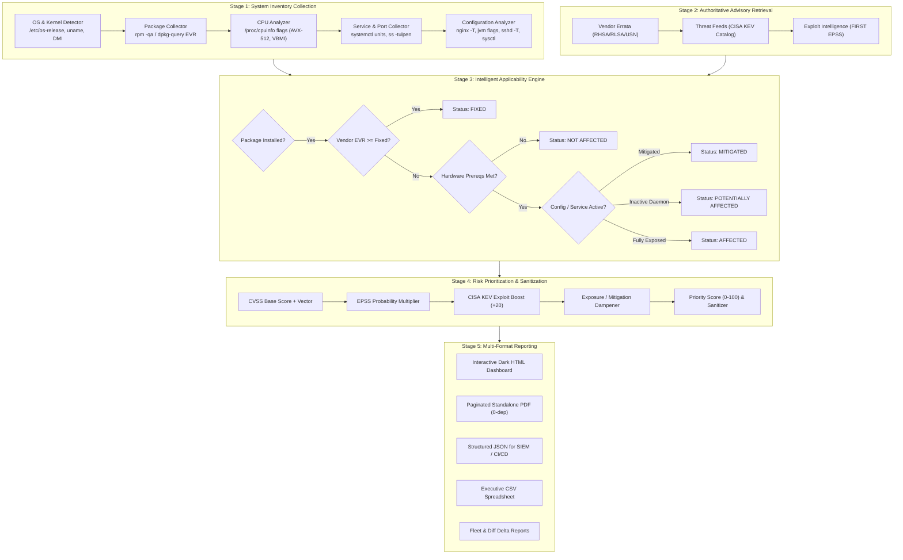

# Linux Vulnerability Scanner & Security Assessment Tool
## Operator Manual & Technical Guide: Installation, Operations, and Report Interpretation

---

### Executive Overview & Design Philosophy

The **Linux Vulnerability Scanner and Security Assessment Tool** is an evidence-backed, read-only vulnerability auditing engine specifically designed for mission-critical enterprise Linux servers. It operates on **Rocky Linux 9 (Blue Onyx), RHEL 8/9, AlmaLinux, CentOS Stream, Ubuntu LTS, Debian stable, and Amazon Linux EC2 instances**.

#### The Core Problem: Why Traditional Scanners Fail on Linux
Traditional vulnerability scanners typically rely on naive upstream version string pattern-matching against the National Vulnerability Database (NVD). In production enterprise Linux environments, this produces overwhelming false-positive rates due to:
1. **Vendor Backporting**: Operating system vendors (such as Red Hat, Rocky, Debian, and Ubuntu) backport security fixes into older upstream versions without bumping the major/minor upstream version string. For example, package `nginx-1.20.1-14.el9_2.3` contains the backported patch for HTTP/2 Rapid Reset (CVE-2023-44487), even though upstream NGINX only fixed it in `1.25.3`. Standard scanners flag `1.20.1` as vulnerable; this engine evaluates the full Epoch-Version-Release (EVR) and authoritative vendor changelog to confirm the package is **Fixed**.
2. **Missing Prerequisite Verification**: Many high-severity CVEs require specific hardware instructions (e.g. AVX-512 VBMI), running background services, or explicit configuration directives (e.g. `listen ... http2;` or OpenSSH `LoginGraceTime`). If an unpatched binary is installed on a host lacking the required CPU instruction set or with the vulnerable feature disabled in configuration, the system is **Not affected** or **Mitigated**, not actively vulnerable.

#### Core Architectural Principles
* **Strictly Read-Only & Non-Destructive**: Never installs software, changes configurations, restarts daemons, or executes exploit payloads. Safe for production environments.
* **Zero External Dependencies**: Core scanning, inventory collection, applicability rules, risk scoring, HTML reporting, JSON/CSV export, and paginated PDF generation require standard Python 3.8+ built-ins only.
* **Evidence-Based Audit Trail**: Every finding provides the exact commands executed on the target host, command output snippets, and verification procedures.
* **Standardized Sections A–G Assessment Structure**: Every evaluated CVE is structured into 7 technical sections designed for both senior security engineers and infrastructure leadership.

---

### Architecture & Assessment Pipeline

The assessment engine executes a sequential 5-stage pipeline:



---

### Installation & Deployment

#### 1. Prerequisites
* **Operating System**: Linux (Rocky Linux 8/9, RHEL 8/9, AlmaLinux, CentOS Stream, Ubuntu 20.04/22.04/24.04, Debian 11/12, Amazon Linux 2/2023) or macOS (for remote audits).
* **Python**: Python 3.8 or higher.
* **Privileges**: Normal non-privileged user or read-only service account. For complete configuration visibility (e.g. reading protected `/etc/nginx/nginx.conf` or executing `sshd -T`), root or targeted `sudo` permissions are recommended.

#### 2. Standalone Mode (Zero Dependencies)
The core scanner, all reporters, and the built-in Web server require **zero pip installations**:

```bash
# 1. Clone the repository
git clone https://github.com/example/linux-vuln-scanner.git
cd linux-vuln-scanner

# 2. Verify launcher script permissions
chmod +x run.sh

# 3. Test CLI functionality
./run.sh --help
```

#### 3. Development / Full UI Mode (Optional)
To enable the optional Streamlit graphical dashboard and native SSH paramiko runner:

```bash
pip install -e .
pip install streamlit paramiko pyyaml
```

---

### Operations & CLI Usage Guide

#### 1. Local System Assessment (`scan-local`)
Assesses the host system currently executing the scanner:

```bash
# Run standard assessment generating all report formats
./run.sh scan-local --output-dir ./reports

# Run with custom host alias and custom report name
./run.sh scan-local \
  --host-alias "prod-api-gateway" \
  --report-name "api-gateway-q4-audit" \
  --output-dir ./reports
```

#### 2. Reference Profile Scenarios (Rocky Linux 9.6)
Evaluates pre-configured reference environments for testing, validation, and training without requiring live system access:

```bash
# Scenario 1: Default production (Unpatched NGINX HTTP/2 + OpenJDK AVX-512 active) -> Affected
./run.sh scan-local --profile rocky9 --scenario default --output-dir ./reports

# Scenario 2: Configuration mitigation active (NGINX HTTP/2 disabled) -> Mitigated
./run.sh scan-local --profile rocky9 --scenario mitigated_nginx --output-dir ./reports

# Scenario 3: Hardware constraint (CPU lacks AVX-512 VBMI instructions) -> Not affected
./run.sh scan-local --profile rocky9 --scenario non_avx512 --output-dir ./reports

# Scenario 4: Vendor security patch verified installed -> Fixed
./run.sh scan-local --profile rocky9 --scenario patched --output-dir ./reports
```

#### 3. Remote Agentless Assessment over SSH (`scan-remote`)
Connects to a remote Linux instance via SSH, executes read-only inventory collection commands, and evaluates findings locally:

```bash
./run.sh scan-remote \
  --host 10.0.1.50 \
  --user ec2-user \
  --key-file ~/.ssh/id_rsa \
  --host-alias "aws-prod-web01" \
  --output-dir ./reports
```

> [!NOTE]
> The remote runner checks every command against a safety blacklist. Commands containing `rm`, `dnf install`, `yum update`, `systemctl restart`, `reboot`, or redirection writes (`>`) are strictly prohibited and aborted.

#### 4. Scoped CVE Auditing (`--cve`)
Focuses the assessment solely on one or more specific CVE identifiers (ideal for incident response or re-auditing specific CVEs after a patching cycle):

```bash
# Target a single CVE
./run.sh scan-local --cve CVE-2021-3156 --profile rocky9

# Target multiple comma-separated CVEs
./run.sh scan-local --cve CVE-2021-3156,CVE-2023-44487 --output-dir ./reports

# Target specific CVEs on a remote host
./run.sh scan-remote --host 10.0.1.50 --user ec2-user --key-file ~/.ssh/id_rsa --cve CVE-2023-38408
```

#### 5. Multi-Server Fleet Assessment (`scan-fleet`)
Assesses an entire group of servers in parallel from an inventory file (`.json`, `.yaml`, or `.csv`):

```bash
./run.sh scan-fleet \
  --fleet-file data/sample_fleet.json \
  --concurrency 5 \
  --depth standard \
  --output-dir ./reports
```

*Sample Inventory File (`inventory.json`)*:
```json
{
  "fleet_name": "Payment Gateway Cluster",
  "servers": [
    {
      "host": "10.0.1.10",
      "user": "ec2-user",
      "key_file": "~/.ssh/id_rsa",
      "alias": "web-prod-01",
      "tags": {"env": "production", "tier": "web"}
    },
    {
      "host": "10.0.1.11",
      "user": "ec2-user",
      "key_file": "~/.ssh/id_rsa",
      "alias": "web-prod-02",
      "tags": {"env": "production", "tier": "web"}
    }
  ]
}
```

#### 6. Historical Scan Comparison & Patch Diffing (`diff`)
Compares a baseline scan JSON against a current scan JSON to track remediation progress and detect regressions:

```bash
./run.sh diff \
  --baseline ./reports/web01-baseline.json \
  --current ./reports/web01-current.json \
  --output-dir ./reports
```

#### 7. Ingesting & Updating Advisories Online (`fetch-cve`)
Queries the Red Hat Security Data API, CISA KEV catalog, and FIRST EPSS intelligence to ingest any new CVE into the local database with full Section A–G metadata:

```bash
# Ingest an authoritative advisory for EL9
./run.sh fetch-cve --cve CVE-2023-38408 --target-os el9

# Ingest multiple CVEs
./run.sh fetch-cve --cve CVE-2023-38408,CVE-2024-6387 --target-os el9
```

#### 8. Interactive User Interfaces (`serve` & `streamlit`)
```bash
# Launch zero-dependency HTTP Web Dashboard (Port 8080)
./run.sh serve --port 8080

# Or launch Streamlit UI (if installed)
streamlit run vulnscan/ui/streamlit_app.py
```

#### 9. Scan Depth Profiles (`--depth`)
Controls the scope of collection and inspection:
* `--depth basic`: Fast package manager (`rpm`/`dpkg`) and open port inspection (~2s).
* `--depth standard` (default): Basic + running systemd services + NGINX directives + JVM flags + CPU `/proc/cpuinfo` flags (~10s).
* `--depth deep`: Standard + unmanaged process discovery (`/proc/*/exe`), OpenSSH daemon audit (`sshd -T`), and Linux kernel `sysctl` security parameters (~20s).

#### 10. Corporate Report Branding & Classification Headers
```bash
./run.sh scan-local \
  --company "Acme Cyber Defense Corp" \
  --assessor "Senior Security Engineer" \
  --classification "STRICTLY CONFIDENTIAL" \
  --depth deep \
  --output-dir ./reports
```

---

### Report Understanding & Findings Anatomy

#### 1. The 6-State Applicability Classification Model

Every finding is assigned one of six authoritative determinations:

| Classification | Meaning & Criteria | Remediation Priority |
|:---|:---|:---|
| **`Affected`** | Confirmed vulnerable package version installed **AND** all prerequisite hardware instruction sets, running services, and active configuration directives are met. Active exploit surface exists. | **High / Immediate** |
| **`Potentially affected`** | Unpatched package is installed and configured, but the vulnerable daemon or process is currently **stopped/inactive**. Exploitation is not immediately possible, but service startup will open the vulnerability. | **Medium** |
| **`Mitigated`** | Unpatched package version is installed, but an active system configuration or workaround (e.g. HTTP/2 disabled, intrinsic disabled) blocks the vulnerable code path. Underlying binary remains unpatched. | **Low / Scheduled Maintenance** |
| **`Fixed`** | Authoritative vendor backported security patch or updated package release is verified installed via RPM/Debian EVR comparison. Vulnerability is resolved. | **None / Resolved** |
| **`Not affected`** | Host lacks the mandatory CPU hardware instructions (e.g. AVX-512 VBMI), or the package is not installed. Code path cannot be physically executed. | **None** |
| **`Unable to determine`** | Custom in-house binary or non-standard package without version banners or changelog metadata. Requires manual signature inspection. | **Investigate** |

---

#### 2. Detailed Anatomy of a CVE Finding (Sections A–G)

Each evaluated vulnerability in the HTML and PDF reports includes seven distinct technical sections:

```
+--------------------------------------------------------------------------------------------------+
| Finding #1: CVE-2023-44487 -- NGINX HTTP/2 Rapid Reset Denial of Service [CISA KEV]     AFFECTED |
| Component: nginx | Installed: 1.20.1-14.el9_2.1 | Fixed: 1.20.1-14.el9_2.3 | CVSS: 7.5 | EPSS: 81.2% |
+--------------------------------------------------------------------------------------------------+
```

##### SECTION A: Vulnerability Overview & Root Cause
* **CVE ID & Title**: Standardized CVE identifier, advisory alias, and vulnerability title.
* **Affected Component**: Target package name and software runtime.
* **Technical Description**: Overview of the flaw, protocol implications, and threat landscape.
* **Root Cause**: Specific software logic failure (e.g. *Stream multiplexing state machine flaw permitting rapid RST_STREAM frame flooding*).
* **CVSS & EPSS**: CVSS v3.1 base score, severity rating, and FIRST EPSS percentile probability.
* **CISA KEV Indicator**: Highlights if the vulnerability is cataloged by CISA as actively exploited in the wild.

##### SECTION B: Environment & Applicability Analysis
* **Host Runtime Context**: Host OS, distribution release, platform ID (`platform:el9`), architecture, and kernel version.
* **Applicability Rationale**: Clear reasoning explaining why the host is affected, mitigated, or fixed.
* **Prerequisites Met**: List of verified conditions (e.g. `service:nginx=active`, `config:http2=enabled`).
* **Prerequisites Shielded/Unmet**: Missing hardware flags or mitigating configuration settings.
* **Vendor Backport Evaluation**: Explains the exact EVR comparison between installed and vendor patched releases.

##### SECTION C: Step-by-Step Findings & Audited Evidence
* **Inspection Commands**: The exact, non-destructive commands executed on the target host.
* **Command Purpose**: What the command investigates.
* **Audited Snippet**: Raw, sanitized terminal output collected from the target server.
* **Expected vs Actual**: Expected output for vulnerable, patched, and mitigated states.

##### SECTION D: Safe Reproduction & Non-Destructive Verification (PoC)
* **Safe Verification Procedure**: Instructions to verify applicability without running exploits or disrupting services.
* **Defensive PoC**: Command to check package EVR or query the local RPM changelog:
  `rpm -q --changelog nginx | grep -B 2 -A 4 -i 'CVE-2023-44487'`

##### SECTION E: Actionable Remediation Guidance
* **Vendor Recommendation**: Official vendor security errata guidance (RHSA/RLSA/USN).
* **Package Manager Command**: The exact remediation command applicable to the target OS:
  `dnf update -y nginx` or `apt-get --only-upgrade install nginx`
* **Operational Impact**: Service restart requirement, system reboot necessity, and business impact.

##### SECTION F: Contextual Risk Assessment & Compensating Controls
* **Inherent vs Operational Risk**: Distinguishes the CVE severity from contextual operational risk (e.g. Inherent High $\rightarrow$ Contextual Low because SSH port is restricted to private VPN).
* **Compensating Controls**: Active boundary protections (e.g. Perimeter VPN isolation, key-based SSH, unprivileged service execution).
* **Residual Risk**: Remaining business risk if patching is deferred.

##### SECTION G: Conclusion & Audit Determination
* **Final Determination**: `AFFECTED`, `POTENTIALLY AFFECTED`, `MITIGATED`, `FIXED`, or `NOT AFFECTED`.
* **Priority Score (0–100)**: Multi-factor score combining CVSS, EPSS probability, CISA KEV status, and operational exposure.
* **Confidence Level**: High, Medium, or Low.
* **Remediation Priority**: Immediate, High, Medium, Low, or None.
* **Risk Justification**: Written rationale for risk acceptance or patching scheduling.

---

### Report Formats Overview

| Report Format | File Pattern | Best Used For | Key Features |
|:---|:---|:---|:---|
| **Interactive HTML** | `<host>-<timestamp>.html` | Security Analysts, SysAdmins | Dark-theme UI, instant client-side search, status/severity filter pills, expandable drawer sections, zero external CDN dependencies. |
| **Standalone PDF** | `<host>-<timestamp>.pdf` | CISOs, Auditors, Executive Leadership | Strictly paginated (Executive Summary on Page 1, exactly 1 finding per dedicated page for Sections A–G), classification banners, zero dependencies. |
| **Structured JSON** | `<host>-<timestamp>.json` | SIEM, CI/CD, DefectDojo, Jira | Complete machine-readable data model including system identity, packages, runtimes, configurations, findings array, and audit timestamps. |
| **Executive CSV** | `<host>-<timestamp>.csv` | Infrastructure Teams, Spreadsheets | Tabular list of findings with CVE ID, component, installed version, fixed version, status, priority score, and remediation command. |
| **Fleet Dashboard** | `fleet-report-<timestamp>.html` | Cloud Operations, IT Leadership | Consolidated multi-server compliance score (% clean), server overview table, and fleet-wide CVE exposure heat matrix. |
| **Diff Delta Report** | `scan-diff-<timestamp>.html` | Change Management, Audit Verification | Tracks newly introduced CVEs, verified remediations, and state transitions between scans. |

---

### Security, Safety & Operational Guardrails

1. **Read-Only Command Safety Guard**:
   Every command dispatched to a local shell or remote SSH session is validated against a safety blacklist. The scanner rejects destructive commands (`rm`, `dd`, `mkfs`, `fdisk`), package modifications (`install`, `remove`, `erase`), process managers (`kill`, `pkill`), and daemon control (`restart`, `stop`, `reboot`).

2. **Secret & Credential Sanitizer**:
   Before evidence is stored or displayed in reports, the `Sanitizer` module redacts:
   * RSA, DSA, EC, and OPENSSH Private Keys (`-----BEGIN ... PRIVATE KEY-----`).
   * AWS Access Keys (`AKIA[0-9A-Z]{16}`) and Secret Access Keys.
   * Passwords, tokens, API keys, and Authorization Bearer headers.

3. **Air-Gapped & Offline Execution**:
   In restricted or air-gapped network environments (`--offline true`), the engine operates without outbound network calls. All evaluations use local caches, seed databases, and local system utilities.
